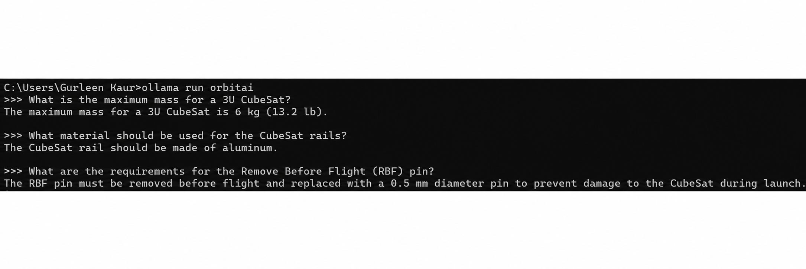
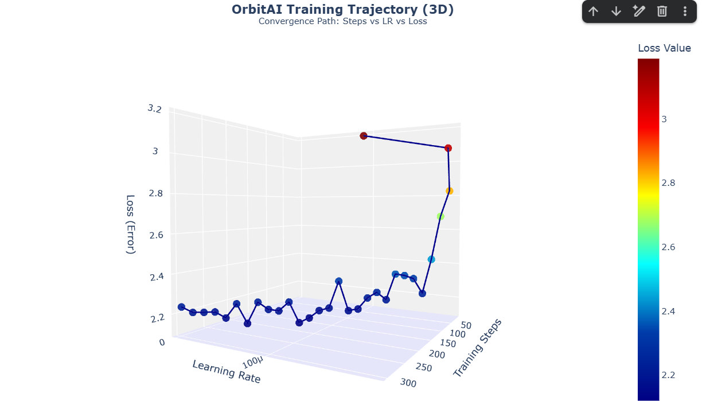

# 🛰️ OrbitAI: Domain-Specific Satellite Engineering LLM


OrbitAI is a domain-specific Large Language Model (LLM) designed to assist satellite engineering teams with technical design, compliance verification, and mission-planning queries.

While general-purpose LLMs possess broad knowledge, they frequently generate outdated or inaccurate responses when applied to highly specialized engineering domains. OrbitAI addresses this challenge by fine-tuning Llama-3-8B on aerospace and satellite engineering standards, enabling standards-compliant reasoning aligned with modern CubeSat requirements.

---

# 🚀 Project Highlights

* Fine-tuned **Llama-3-8B** using **LoRA (Low-Rank Adaptation)** for parameter-efficient domain adaptation.
* Curated a custom engineering dataset from **10+ aerospace technical standards and manuals**.
* Built an end-to-end **MLOps pipeline** covering data extraction, dataset generation, fine-tuning, quantization, and deployment.
* Reduced training loss from **3.18 → 2.23** during supervised instruction tuning.
* Quantized the model to **GGUF (q4_k_m)** for efficient local CPU inference.
* Deployed locally using **Ollama**.
* Demonstrated improved compliance with modern aerospace engineering standards compared to the base model.

---

# 🎯 Problem Statement

Large Language Models are highly capable general-purpose assistants but often struggle with engineering domains where precision, safety, and standards compliance are critical.

For example:

### Base Llama-3 Response

Reports a 3U CubeSat mass limit of **4 kg**, reflecting outdated specifications.

### OrbitAI Response

Correctly enforces the **6 kg mass limit** defined in CDS Rev 14.1.

This highlights the importance of domain adaptation when deploying LLMs in engineering workflows where incorrect specifications may lead to costly design errors and compliance violations.

---

# 📊 Dataset

OrbitAI was trained using a custom instruction-tuning dataset derived from aerospace and satellite engineering documentation.

## Data Sources

* CubeSat Design Specification (CDS Rev 14.1)
* ISRO Satellite Guidelines
* NASA Technical Standards
* Aerospace Material Specifications
* Launch Safety and Compliance Documentation

## Dataset Statistics

| Metric                     | Value                                        |
| -------------------------- | -------------------------------------------- |
| Technical Documents        | 10+                                          |
| Engineering Documentation  | 500+ Pages                                   |
| Instruction-Response Pairs | 3,000+                                       |
| Domain                     | Satellite Engineering & Aerospace Compliance |

## Data Pipeline

1. Extracted text from technical PDF manuals.
2. Cleaned and structured engineering content.
3. Generated instruction-response training pairs.
4. Converted data into supervised fine-tuning format.
5. Validated outputs for engineering consistency.

---

# 🛠️ Model Training

## Base Model

```text
Llama-3-8B (Unsloth)
```

## Fine-Tuning Method

```text
LoRA (Low-Rank Adaptation)
```

## Training Objective

Adapt a general-purpose LLM into a domain-specific engineering assistant capable of:

* Technical standards interpretation
* Design compliance verification
* Engineering reasoning
* Satellite subsystem guidance

## Training Results

| Metric             | Value  |
| ------------------ | ------ |
| Initial Loss       | 3.18   |
| Final Loss         | 2.23   |
| Fine-Tuning Method | LoRA   |
| Deployment Format  | GGUF   |
| Quantization       | q4_k_m |

---

# 📈 Evaluation Results

OrbitAI was evaluated on representative satellite engineering tasks covering:

* Mass Constraints
* Material Selection
* Safety Procedures
* Compliance Validation

## Validation Summary

### ✅ Mass Constraint Test

**Question**

```text
What is the maximum allowable mass of a 3U CubeSat?
```

**Base Llama-3**

```text
4 kg
```

**OrbitAI**

```text
6 kg (CDS Rev 14.1)
```

### ✅ Material Selection Test

Correctly recommends:

```text
Hard Anodized Aluminum 7075
```

for CubeSat structural applications.

### ✅ Safety Procedure Test

Correctly identifies:

```text
Remove Before Flight (RBF) pin requirements
```

and associated launch safety constraints.

## Benchmark Screenshots



---

# 📉 Training Visualization

The figure below visualizes model convergence throughout fine-tuning.



*Loss convergence during LoRA-based instruction tuning.*

---

# 🚀 Deployment

OrbitAI is optimized for local deployment using Ollama.

## Model Optimization Pipeline

```text
Llama-3-8B
    ↓
LoRA Fine-Tuning
    ↓
Merge Adapters
    ↓
GGUF Quantization
    ↓
Ollama Deployment
```

## Inference Configuration

| Component       | Value           |
| --------------- | --------------- |
| Runtime         | Ollama          |
| Quantization    | GGUF q4_k_m     |
| Hardware        | CPU Compatible  |
| Deployment Mode | Local Inference |

---

# 💻 How to Run Locally

## Prerequisites

1. Install Ollama
2. Clone this repository

## Download Model

Due to GitHub file size limits, download:

```text
orbitai.gguf
```

from:

```text
https://drive.google.com/file/d/1SsurUrELyIU3dM_Rw19oWyRMX-aVz7ag/view
```

Place the file inside:

```text
models/
```

## Register Model

```bash
ollama create orbitai -f Modelfile
```

## Run Model

```bash
ollama run orbitai
```

---

# 📂 Repository Structure

```text
OrbitAI/
├── assets/                 # Benchmark screenshots and visualizations
├── models/                 # Quantized model and configuration files
├── src/                    # Data preprocessing and utility scripts
├── requirements.txt
├── Modelfile
└── README.md
```

---

# 🔮 Future Work

* Retrieval-Augmented Generation (RAG) integration
* Expanded aerospace standards coverage
* Multi-modal engineering document understanding
* Fine-tuning on mission design reports
* Automated compliance auditing workflows

