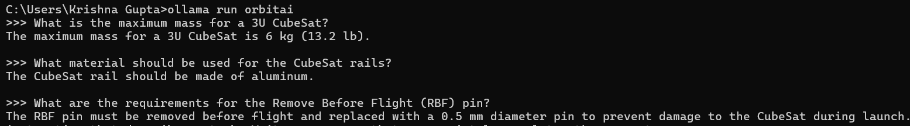

# 🛰️ OrbitAI: Domain-Specific Satellite Engineering LLM


**OrbitAI** is a specialized Large Language Model (LLM) engineered to assist the **Student Satellite Club** with technical compliance and design queries. 

Unlike generic models (like ChatGPT) which often hallucinate engineering specs, OrbitAI was fine-tuned on **10+ critical technical documents** (including **CDS Rev 14.1** and **ISRO** guidelines), effectively "overwriting" general knowledge with strict domain constraints.

---

## 🎯 The Engineering Problem
Generic LLMs are trained on the broad internet. When asked about specific engineering standards, they often default to outdated or incorrect information.
* **The Error:** Base Llama-3 claims a 3U CubeSat is limited to **4 kg** (an outdated standard).
* **The Fix:** OrbitAI correctly enforces the modern **6 kg** limit per CDS Rev 14.

---

## 📸 Performance Benchmarks
We evaluated OrbitAI locally using Ollama. Below is the validation output demonstrating correct domain alignment across three critical engineering categories: **Mass Constraints**, **Material Selection**, and **Safety Procedures**.

### ✅ Verification Proof
> **1. Mass Test:** Correctly identifies the **6 kg** limit (vs 4 kg base model).
> **2. Material Test:** Specifies **Aluminum** (Hard Anodized 7075).
> **3. Safety Test:** Correctly defines the RBF (Remove Before Flight) pin requirements.



---

## 🛠️ Technical Pipeline
The project follows a complete MLOps lifecycle:

1.  **Data Engineering:**
    * Extracted raw text from **10 technical PDF manuals** (CDS, ISRO, NASA standards).
    * Synthesized high-quality Instruction-Response pairs for supervised fine-tuning.
2.  **Fine-Tuning (LoRA):**
    * **Base Model:** Llama-3-8b-Unsloth
    * **Training Loss:** Dropped from `3.18` $\to$ `2.23`, indicating successful knowledge ingestion.
3.  **Deployment:**
    * Merged LoRA adapters with base model.
    * Quantized to **GGUF (q4_k_m)** for efficient CPU inference.
    * Deployed locally via **Ollama**.


*(Visualizing the convergence of Loss over training steps)*

---

## 💻 How to Run Locally

### Prerequisites
1.  Install [Ollama](https://ollama.com).
2.  Clone this repository.

### Setup
1.  **Download the Model:**
    Due to GitHub file size limits, download `orbitai.gguf` from [Insert Link if hosted] or generate it using the notebooks provided. Place it in the `models/` folder.

2.  **Register the Model:**
    Run this command in your terminal:
    ```bash
    ollama create orbitai -f Modelfile
    ```

3.  **Chat:**
    ```bash
    ollama run orbitai
    ```

---

## 📂 Repository Structure

```text
OrbitAI/
├── assets/             # Benchmark screenshots and graphs
├── data/               # Raw PDFs (x10) and processed JSONL datasets
├── models/             # Modelfile and Adapter configs
├── notebooks/          # Google Colab training scripts
├── src/                # Python scripts for data processing
└── README.md           # Documentation